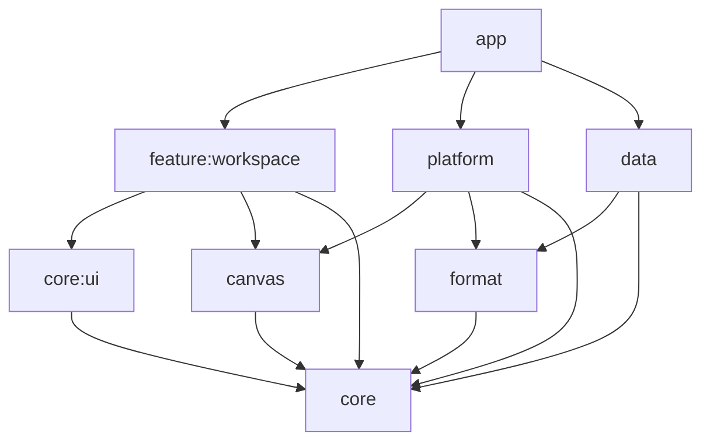

# Lokalna arhitektura — kvalifikovana 0.6.5 i razvoj F05

Odluka od 31. oktobra 2026. zamenjuje online arhitekturu za trenutni obim rada. Istorijske odluke ostaju u ARCHITECTURE.md. Korisnikov prilog se primenjuje na lokalnu aplikaciju; mrežni primeri ne dodaju mrežne zavisnosti.

## Aktuelne dopune, 4. novembar 2026.

Provereni izvor je 0.6.4/9589e12: LOCAL-0.6.4-CANDIDATE.md. AppCompatActivity i AppCompatDelegate pripadaju composition root-u; domen ima samo AppLanguage vrednosti bez Android Context-a. Jedan framework mehanizam čuva izabrani jezik, uz AppCompat auto-storage pre API 33 i sistemsko čuvanje od API 33. Nema paralelnog DataStore jezičkog ključa.

Feature pretvara 37 resource ključeva u potpun immutable TemplateContent snimak pri potvrdi nove table. ViewModel/use-case ga prosleđuje domenskom TemplateFactory-ju. Čuva se stvarni tekst dokumenta; promena jezika ne ponavlja generisanje starog sadržaja. JSON i Room ostaju 4.

Page.geometry povezuje postojeće bounds/picking/preview potrošače sa jednim immutable snapshot-om; preview čuva slojeve i ne menja session. Connector/ConnectorEnd i batch port resolver još su izolovano jezgro, izvan Element/format/UI integracije. Njihovo postojanje ne znači aktivan konektorski alat. Pencil koristi jednu determinističnu 32×32 teksturu i najviše 16 tint filtera po renderer-u, bez dodatnog rada po svakom uzorku tačke ili novih runtime zavisnosti.

Aktuelni accessibility prozor ima najviše 256 vidljivih virtuelnih čvorova, prema MAX_VISIBLE_NODES u CanvasAccessibility; Objects ostaje potpun pretraživ navigator stranice. Kvalifikovana 0.6.5 uvodi kontrolisano otvaranje istog Selection actions menija, uz native otkazivu long-press odgodu, tastaturu i imenovanu virtual-node akciju. Akcije i Undo ostaju u postojećem ViewModel/session toku: OBJECT-CONTEXT-MENU.md i LOCAL-0.6.5-CANDIDATE.md.

Razvoj F05.3 odvaja PageContent od Page metapodataka: viewport/naziv/pozadina dele isti validirani content snapshot i lenju world geometriju. PageGeometry facade pokazuje aktuelnu stranicu; izmena liste ili ID-ja invalidira sadržaj. Portovi i batch resolver su u core/model, sa otkazivim pripremanjem i objavljivanjem potpunog indeksa. PAGE-GEOMETRY-SNAPSHOTS.md razdvaja ovaj izvor od kvalifikovanog APK-a i opisuje ograničenja. Connector još nije korisnički alat ili Element u formatu 4.

## Granice i vlasništvo

App je composition root i jedino mesto spajanja Android adaptera sa domenom preko Hilt-a. Singleton adapteri koriste ApplicationContext; ViewModel-i imaju lifecycle scope. Domen je Kotlin bez Android/Hilt/Room/Compose zavisnosti. Feature poznaje modele i Use Case-ove, a ne repository portove ili implementacije.

ManageLibrary preuzima bibliotečke promene, pretragu, sortiranje i datoteke sličica. Pretraga je debounced, mapLatest otkazuje staru pretragu, greška upita ne prekida sledeći upit. ViewModel retry ponovo pokreće prekinut repository observation. ManagePreferences normalizuje korisničke izmene podešavanja. DocumentTransfers proverava sistemske content URI-je i usmerava import/export/backup u port. EditorPersistence mutex serijalizuje Save/recovery/discard uz reviziju dokumenta.

ViewModel-i izlažu jedno StateFlow stanje, immutable snapshots i eksplicitne akcije. collectAsStateWithLifecycle prati lifecycle. Notice identitet sprečava da potvrda stare poruke obriše novu grešku. CancellationException se propagira; greške ne sadrže privatne putanje ili sirove ulazne podatke. IO i računanje imaju injektovane dispatchere u domen/adapter sloju; bitmap dekodiranje prezentacije radi van Main niti.

## Dokument i snimanje

DocumentSession poseduje dokument i istoriju. Canvas poseduje nedovršene poteze, viewport i gesture preview; završeni gest postaje logička komanda. Grupisanje, Fill i clipboard poštuju Undo/Redo identitete. Bitmap/path cache i vidljivi bounds ograničavaju rad renderera.

Room schema 4 koristi nedestruktivne migracije 1→2→3→4. Veliki JSON se deli na ograničene redove, u jednoj transakciji sa metapodacima. Provereni paket 0.5.1 piše JSON 3 i čita 1–3. Razvojna 0.6.0 piše JSON 4 i čita 1–4; SQL struktura ostaje ista. Stariji paket ne čita novi afinni sadržaj, pa downgrade nije podržan put prenosa dokumenata. Online tabele su kompatibilnosni ostatak, bez aktivnog klijenta, servisa ili scheduler-a. Ne uvodi se migration downgrade ili fallbackToDestructiveMigration.

Parcijalna gumica koristi domensku geometriju kapsule i `StrokeCut` snimke za atomsku primenu jednog gesta. Prikaz do podizanja prsta ostaje u canvas adapteru. Rotacija 0.6.0 ima čist afinni model za pravougaoni sadržaj; potezi/linije ostaju polilinije u koordinatama dokumenta. Računanje plana preko injektovanog AppDispatchers.computation ne menja sesiju; primena na Main niti ponovo proverava početnu stranicu. Pravila geometrije, resize-a i formata su u OBJECT-ROTATION-DESIGN.md; integraciona kvalifikacija je odvojena od arhitektonske odluke.

Save uhvati reviziju pre suspend upisa. Paralelni UI Save se ignoriše dok prvi traje, a njegov busy status ne sme biti poništen drugim zahtevom. Novije izmene ostaju dirty i u recovery-u. Ako je autosave uključen, uspešan spor Save zakazuje sledeće snimanje tih izmena. Neuspeh ne pokreće beskonačan automatski retry; prikazuje se korisnički retry. Back tokom snimanja ostaje potrošen u editoru.

Privatni prilozi se referenciraju validiranim ID-jevima. Trenutni dokument, Undo/Redo i privatni clipboard štite potrebne datoteke od čišćenja. Backup uvozi kopije sa novim ID-jevima i validira priloge pre commit-a. Sličice su potrošni cache: IO adapter dozvoljava samo PNG iz privatnog thumbnails direktorijuma, do 2 MiB; dekoder prihvata najviše 1024×1024 piksela.

## Adaptivnost i distribucija

Raspored prati veličinu dostupnog prozora, bez zaključane orijentacije/resize zabrane. Compose upravlja navigacijom, dijalozima i sistemskim picker-ima; mali tekstovi/ID-jevi koriste saveable state, dokumenti nisu Bundle payload. Native View obrađuje touch/stylus, wheel pan i Ctrl/Meta zoom; Activity usmerava dostupne prečice u editor. Stvarni mouse/stylus/foldable i accessibility prolazi ostaju zasebna kvalifikacija.

Debug ima applicationIdSuffix .debug i opcionu LeakCanary zavisnost. Release uključuje R8/resource shrinking, bez mrežnih/debug SDK-ova. Zavisnosti i finalni APK se proveravaju zasebno; odsustvo nalaza nije garancija svih bezbednosnih svojstava.
# Dopuna 0.4: pristupačno platno i životni ciklus

`WhiteboardView` izlaže vidljive objekte kao virtuelne accessibility čvorove preko `ExploreByTouchHelper`. Najviše 256 vidljivih čvorova ograničava cenu povezane hijerarhije; dijalog Objects pretražuje celu stranicu, uključujući objekte van prikaza. Pretraga se otkazuje i izvršava na CPU dispatcher-u. Izbor objekta otkriva njegove granice na platnu.

ID-jevi čvorova su stabilni unutar stranice, a promena stranice poništava mapiranje čak i kada uvezeni objekti imaju iste ID-jeve. Callback čita aktuelni immutable snapshot iz ViewModel-a pre svake akcije; Compose render frejm nije izvor istine za komande. Relativno pomeranje/skaliranje rešava se u `DocumentSession`, a izmena teksta ponovo pronalazi poslednju verziju objekta pri potvrdi. Time brza sekvenca pomeranje → izmena ne vraća raniju geometriju.

Vidljiv fokus, 48 dp ciljevi, imenovani slider-i i akcije birača boja dopunjuju alternative gestovima: dodavanje, izbor, pomeranje, veličina, brisanje i navigacija kamerom. Accessibility adapter ne snima dokument samostalno i ne uvodi paralelnu istoriju.

Bitmap loader ima generaciju životnog ciklusa. Rezultat starog blokirajućeg dekodiranja ne može upisati bitmap ili ukloniti pending zahtev novog attachment-a posle detach/reattach. Keš ostaje ograničen na 24 MB; evikcija ne reciklira bitmap koji RenderThread možda još koristi.

LeakCanary i Shark postoje samo u dijagnostičkom debug/test grafu. Dodatni `src/qualification/kotlin` testovi uključuju se sa `-Pwhiteboard.qualificationTests=true -Pwhiteboard.leakDetection=true`; AGP 9 koristi `AndroidSourceSet.kotlin`, a ne Java source direktorijum za ove Kotlin izvore. Redovni CI testovi ne uključuju te tri kvalifikacione klase.
